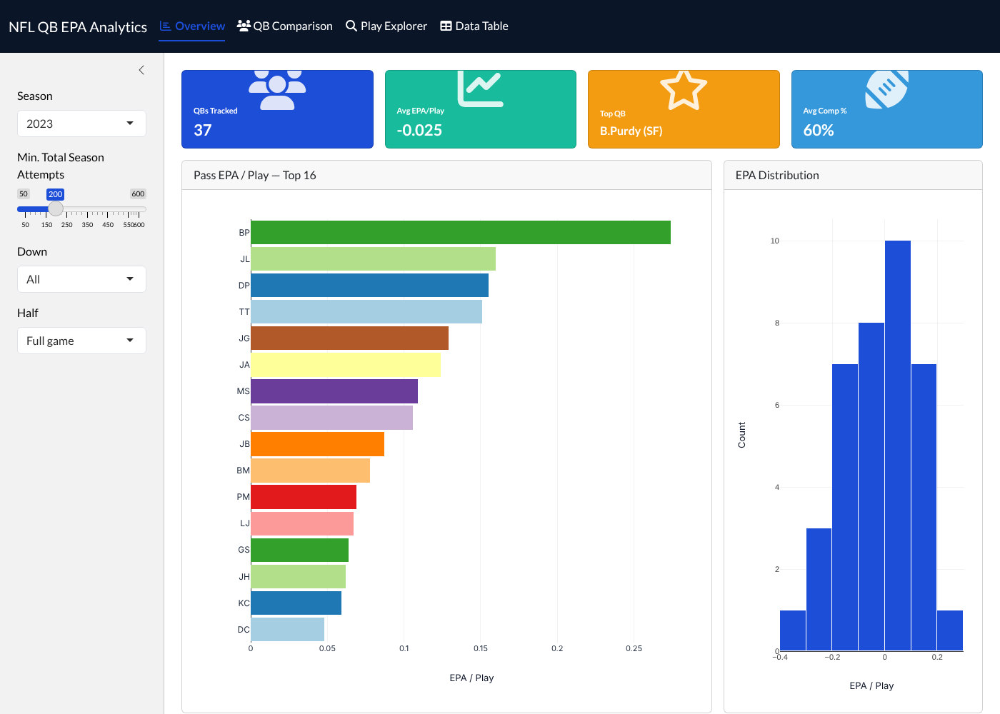
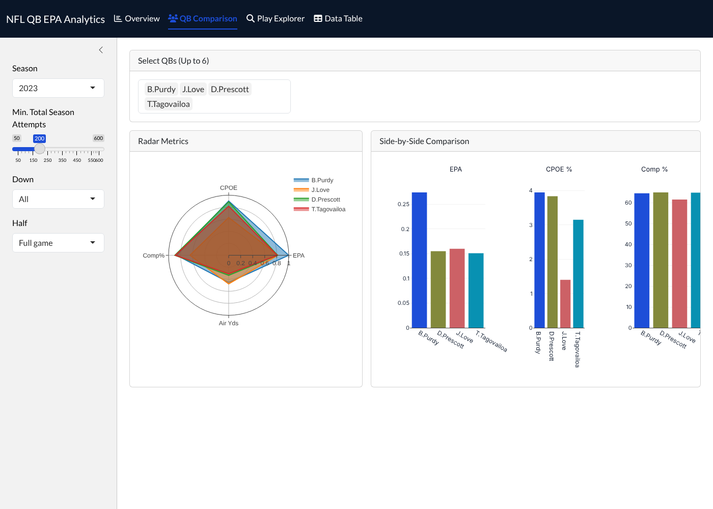

# NFL QB EPA Analytics Dashboard

An interactive R Shiny dashboard for exploring NFL quarterback passing efficiency using **Expected Points Added (EPA)** from the 2022 and 2023 seasons.



## Features

- **Overview**: summary metrics, top 16 QBs by EPA per pass play, the EPA distribution, and an efficiency vs. accuracy (EPA vs. CPOE) scatter
- **QB Comparison**: pick up to 6 quarterbacks and compare them on a radar chart and side-by-side bars (EPA, CPOE, completion %)
- **Play Explorer**: every pass play for one QB, plotted by field position and by air yards with a LOESS trend line
- **Data Table**: sortable, searchable stats for every qualifying QB
- **Filters**: season (2022, 2023, or both), minimum attempts, down, and half



## Built with

R · Shiny · bslib · plotly · DT · dplyr · nflverse play-by-play data

## Run it locally

1. Install R (and RStudio, if you want it).
2. Install the packages:
   ```r
   install.packages(c("shiny", "bslib", "dplyr", "plotly", "DT", "RColorBrewer"))
   ```
3. Clone or download this repo, open `nfl-qb-epa-dashboard.Rproj`, then run:
   ```r
   shiny::runApp()
   ```

## Data

`pbp_data.rds` holds every pass play from the 2022–2023 regular and postseasons. It comes from [nflverse](https://github.com/nflverse) play-by-play data, trimmed to the columns the app uses. To rebuild it or add seasons, edit and run `data-raw/build_data.R` (requires the `nflreadr` package).

## Key metrics

- **EPA / play**: how many expected points a pass play added or lost, averaged per attempt
- **CPOE**: completion percentage over expected, given the difficulty of each throw
- **Air yards**: how far the ball traveled past the line of scrimmage
